  

<h1 align="center">Hello 👋, I'm Adeeb Sharar</h1>
<h3 align="center">CSE Student from Bangladesh 🇧🇩 · Robotics R&amp;D Intern</h3>

  I learn by building practical projects, solving programming problems, and experimenting with hardware. 
  My long-term interests are <strong>Artificial Intelligence, Machine Learning, and Cybersecurity</strong>.

  <a href="https://github.com/ash01-forge?tab=repositories"><strong>Explore my projects</strong></a>
  &nbsp; · &nbsp;
  <a href="https://www.linkedin.com/in/adeeb-sharar-093485447/"><strong>Connect on LinkedIn</strong></a>

  
  &nbsp;
  
  &nbsp;
  
  &nbsp;
  

 

### A little about me

- 🎓 Studying **Computer Science & Engineering at United International University**.
- 🤖 Participating in a **hardware-focused Robotics R&D internship under UIU Robotics**.
- 🌱 Strengthening my foundations in **C, C++, Java, DSA, and SQL**.
- 🔎 Exploring **AI/ML and cybersecurity** as future study and project directions.
- 🛠️ Working on **team projects, sensor experiments, and programming practice**.
- 🤝 Interested in **student research, learning opportunities, and collaboration**.

 

### Find me online

  
  &nbsp;
  

### Languages & project tools

These technologies appear in my coursework and projects. My project READMEs explain the work and team contributions in more detail.

**Programming foundations**

**Web project technologies**

**Database**

**Hardware & embedded projects**

 &nbsp; <strong>ESP32 · Sensors · I2C</strong>

**Development tools**

### Projects to explore

| Project | What you'll find |
| --- | --- |
| [**BlueCycle**](https://github.com/ash01-forge/BlueCycle-Smart-Pond-Monitoring-System) | University team prototype for pond monitoring using ESP32, Arduino, sensors, pump control, and feeding. Includes firmware, setup notes, and a simulated showcase. |
| [**ThreadFlow**](https://github.com/ash01-forge/ThreadFlow) | A team-built garment production system. My documented work includes buyer/order workflows, change requests, commitment risk analysis, authentication, and shared interface improvements. |
| [**UIU Used Textbook Marketplace**](https://github.com/ash01-forge/UIU-Used-Textbook-Marketplace) | A team marketplace using PHP and MySQL. My documented contributions include shared backend/authentication, schema and migrations, admin workflows, and frontend/API integration. |
| [**Java Contact Manager**](https://github.com/ash01-forge/Java-Contact-Manager) | A Java Swing contact-management project with file storage and a Codespaces setup for running the original GUI. |

Team contribution details are available in the corresponding project READMEs.

### Learning collections

- 📚 [**DSA-I & DSA-II**](https://github.com/ash01-forge/DSA) — C/C++ exercises, assignments, graph algorithms, greedy methods, DP, and study references.
- 💻 [**C Programming Practice**](https://github.com/ash01-forge/C-Programming_Practice_Codes) — Topic-organized programming fundamentals and exercises.
- ☕ [**Java Practice**](https://github.com/ash01-forge/Java-Practice-Codes) — Coursework, OOP, and practice programs.

### Engineering habits I'm developing

Clear setup instructions · Reproducible demos · Meaningful tests · Honest contribution notes

The marketplace repository already includes [automated syntax and selected regression checks](https://github.com/ash01-forge/UIU-Used-Textbook-Marketplace/actions/workflows/marketplace.yml).

---

<strong>Learning steadily. Building with purpose.</strong> Open to exchanging ideas with students, researchers, and mentors.

Layout inspired by <a href="https://github.com/supuna97">supuna97</a>; original banner and coding illustration made for Adeeb. Icons by <a href="https://github.com/tandpfun/skill-icons">Skill Icons</a> — see <a href="./SKILL-ICONS-LICENSE.txt">icon license</a>.
